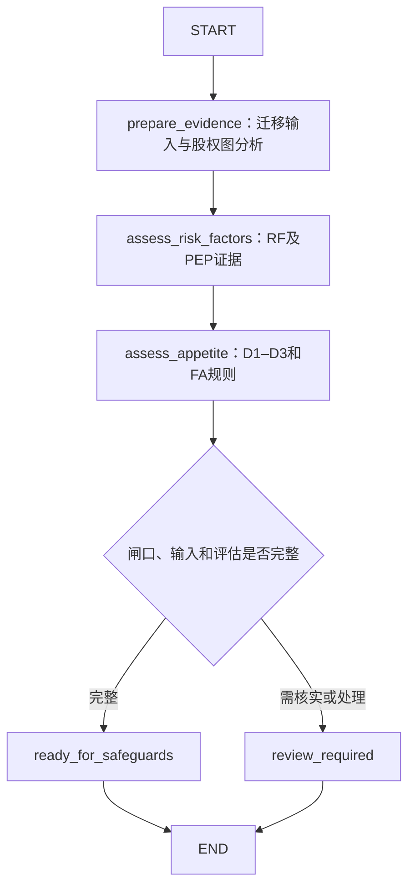

# Appetite 的 LangGraph 接入

本模块使用 Python 3.11+，复用 policy_engine.py 的证据和规则判断，不需要 LLM 或模型 API Key。LangGraph 负责编排；LangChain 的 Runnable 接口可直接调用编译后的 graph。

## 安装与运行

在仓库根目录执行：

```bash
python3 -m venv .venv
source .venv/bin/activate
python -m pip install -r requirements-langgraph.txt
python appetite.py --case case01
python appetite.py --output appetite-results.json
python -m unittest discover -s tests -v
```

`--json` 指向现有格式的数据集，`--case` 精确匹配 test_case_id，省略则运行全部案例；`--rules-dir` 可指定规则工作簿目录。

## 工作流



保留三维度 MAX、Pending 优先及 PEP 最低 Conditional 的规则。缺少事实保持未知。股权图输入经过与原批处理完全相同的准备步骤。RF 在本子图内部由同一份证据计算，避免调用方遗漏 PEP 因子。

输出含 `dimensions`、`final_appetite`、`appetite_rule_ids`、`risk_assessment`、`ownership_analysis`、`assessment_id` 和审计信息。`next_step` 为 `safeguards` 或 `review_required`。后者包括确认 HardGate、待核实闸口、补件和输入错误；应读取 risk_assessment 中的具体原因。这里的 review_required 是处理出口，不包含人工暂停或审批功能。

`Within`、`Conditional`、`Restricted` 是 Appetite 等级，不代表准入接受。最终准入仍需原有 Safeguards 和 Policy Integration。本次范围止于 Appetite 与后续步骤交接。

## 在 Python / 上层 LangGraph 中使用

```python
import json
from appetite import build_appetite_graph

case = json.load(open('test_cases_data.json', encoding='utf-8'))['test_cases'][0]
appetite = build_appetite_graph()
result = appetite.invoke({'case': case})
print(result['final_appetite'], result['next_step'])

# 查看每个节点的更新
for event in appetite.stream({'case': case}, stream_mode='updates'):
    print(event)
```

输入 `case` 是现有数据集 test_cases 中的单个对象，证据位置保持为 `case.data.WorkflowEvidence`。可将此 compiled graph 作为上层图的节点；上层 State 应包含 `case` 及需要接收的输出字段，也可通过适配节点映射。补件后提交完整 case 重新运行。默认无持久化；需要时可由调用方给 build_appetite_graph(checkpointer=...) 传入 checkpointer，并管理 thread_id。

## 可选：LangGraph 本地服务 / Studio

```bash
python -m pip install -r requirements-langgraph-dev.txt
langgraph dev
```

`langgraph.json` 注册了名为 `appetite` 的图，入口 `appetite.py:graph`。请求输入为 `{"case": <单个案例对象>}`。开发服务所需的 LangSmith 登录或配置按 CLI 提示完成。核心 Python 图运行无需这些服务。此次已验证 Python 图与命令行；可选开发服务及线上部署未执行。

## 变更与验证

新增 appetite.py、langgraph.json、两份依赖文件和测试。policy_engine.py 只提取共享 prepare_workflow_evidence，原批处理调用该函数，以便迁移和股权处理保持一致。174 个静态案例逐项对比独立 Appetite 预期与原引擎的维度、RF、命中规则、股权输出；同时验证输入未被修改和图重复调用隔离。原测试继续运行。
