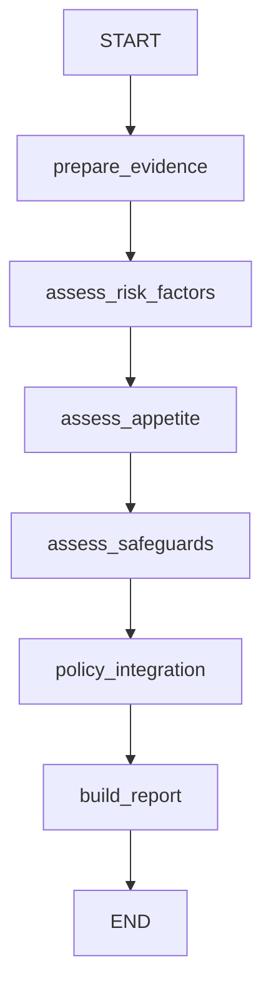

# 第二步：完整 AML LangGraph 工作流

## 如何连接

入口是 workflow_graph.py，图名 aml_workflow。每个节点接收共享 State，返回自己计算出的字段，LangGraph 合并这些字段并传给下一节点。

| 节点 | 调用现有函数 | 写入 State |
| --- | --- | --- |
| prepare_evidence | case_from_json、prepare_workflow_evidence | evidence、ownership_analysis |
| assess_risk_factors | evaluate_rf | risk_assessment（HardGate、DocGate、评分、RiskBand） |
| assess_appetite | evaluate_dimensions | dimensions、final_appetite、appetite_rule_ids |
| assess_safeguards | evaluate_safeguards | safeguards |
| policy_integration | integrate | final_decision（含授权状态和必要审批角色） |
| build_report | format_workflow_result | result（完整业务结果和审计） |

连接方式在 build_workflow_graph 中：

```python
builder.add_node(name, node)        # 把 Python 函数注册成节点
builder.add_edge(previous, name)    # 前一节点完成后，执行当前节点
```



HardGate、DocGate 和 RF 评分沿用原 evaluate_rf 的统一实现，不重复判断。待补件时原引擎已暂停正式计分，但仍提供审计小计。

Appetite 节点直接复用 evaluate_dimensions；完整图不嵌套独立 appetite.py 图，因为独立图会再次准备输入和计算 RF，并在 review_required 出口结束。独立 Appetite 入口仍可使用。

本阶段与原批处理保持一致：即使闸口未清除，也计算后续诊断信息，由 integrate 按工作簿优先级给最终结论。后续诊断不覆盖确认禁止，不自动接受客户。所有 PI-01～11 保留原有优先级；High RiskBand 和 Restricted Appetite 不自动等于拒绝。

## 本地运行

在 Fyp_ontology 根目录：

```bash
python3 -m venv .venv
source .venv/bin/activate
python -m pip install -r requirements-langgraph.txt

# 单个案例；终端 stderr 显示每个节点的更新，文件保存最终结果
python workflow_graph.py --case case01 --trace --output case01-result.json

# 全部174个案例并核对独立预期
python workflow_graph.py --check-expected --output workflow-results.json

# 全部测试
python -m unittest discover -s tests -v
```

当前云工作区已有环境时，也可将 python 替换为 /workspace/.venvs/fyp-ontology/bin/python。

--json 指向现有格式的数据集，--case 精确选择 test_case_id。--rules-dir 可指定三个政策工作簿的目录。--check-expected 核对最终规则、结果、Appetite 和分值；不匹配或缺少预期字段返回非零。--trace 包含节点证据数据，使用真实客户资料时应控制终端和日志访问。

## 在 Python 中调用

```python
import json
from workflow_graph import build_workflow_graph

with open('test_cases_data.json', encoding='utf-8') as source:
    case = json.load(source)['test_cases'][0]

workflow = build_workflow_graph()
output = workflow.invoke({'case': case})
result = output['result']
print(result['risk_assessment'])
print(result['final_appetite'])
print(result['safeguards']['status'])
print(result['final_decision'])

# 如需观察各节点，可另执行一次流式调用；这会重新评估案例
for event in workflow.stream({'case': case}, stream_mode='updates'):
    print(event)
```

invoke 的输入为 {"case": 单个现有案例对象}，输出为 {"result": 完整结果}。result 与原 assess_workflow 的输出一致，评估时间按每次运行生成。

## LangGraph 开发服务（可选）

```bash
python -m pip install -r requirements-langgraph-dev.txt
langgraph dev
```

langgraph.json 同时注册 appetite 和 aml_workflow。选择 aml_workflow，输入 {"case": 单个案例对象}。开发服务/Studio 需要的登录或配置按 CLI 提示处理；本次验证涵盖 Python 图和命令行，未运行开发服务，也未线上部署。

## 验证与范围

174 个静态案例逐项核对独立预期；完整图输出与原批处理逐字段比较，仅排除每次运行不同的 evaluated_at。检查全部11条最终 PI 规则覆盖、节点顺序、跨案例隔离、输入未被修改、命令行导出，以及错误预期返回非零。

当前读取 WorkflowEvidence 内已有的 approvals 并验证授权，不会生成新签署。尚未实现补件等待、人工 interrupt、数据库 checkpoint 或线上 API；这些属于第三步及后续部署工作。
