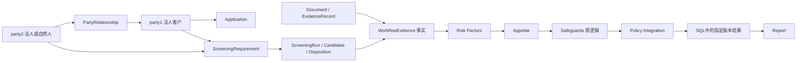

# 客户评估数据库／Report 交接

## 边界

评估客户 AML 风险，不评估产品适合性、投资组合、认购或交收。party1 保持 legal person，party2 保持原角色；原有 Safeguards 逻辑不变。Ontology 和规则引擎输出 JSON，数据库伙伴写入 SQL／对象存储／图数据库，Report 读取指定版本。

这次交付包含类型约束、关系、确定性计算和输出契约，不是新增一套 OWL/RDF 推理系统。默认不连接任何外部数据库，不声称文件、筛查或审批已经真实核实。

## 输入与版本

现有案例格式不变，在 data 下增加 CustomerAssessment；规范见 schemas/customer-assessment.schema.json。完整可运行合成输入见 examples/customer-input.json。所有示例身份、文件引用、筛查和批准都是测试断言，不是真实业务核实。

CustomerAssessment 包含 context、company_profile、party_relationships、screening_requirements、screening_runs、evidence_records 和 funding_background。前三项必需关系和筛查要求不得通过缺省值被视为已完成；company_profile／funding_background 可逐步提供，缺少资料不由引擎编造。

context 必须提供 organization_id、case_id、assessment_version（正整数）、as_of（带时区 ISO 时间）。旧 application_id 和 RA-application_id 继续保留兼容；数据库以 organization_id + case_id + assessment_version + run_id 定位精确结果，不应仅依赖旧 assessment_id。

run_id 每次执行唯一；同样输入可以有多个执行。supersedes_snapshot_id 记录前一快照引用，实际唯一性、前驱存在性、版本递增和撤回操作需数据库／工作流事务验证，本地纯函数无法验证历史库。

输入快照 hash 覆盖 data 的业务内容，排除 CustomerAssessment.context、WorkflowEvidence.approvals 及旧 ApprovalEvidence，避免签名内容自引用。完整原始 data 仍保存于 input_snapshot。机构／案件／评估版本在批准上另作显式比较；规则包 hash 是三个工作簿哈希字典的规范 JSON 哈希。禁止把输入标记为已核实作为可信身份认证的替代。

## 主体和关系字典

| 对象 | 主键与关键字段 | 约束／语义 |
| --- | --- | --- |
| party1 | party_id、原有属性 | 始终 LegalEntity，不改名、不拆类 |
| party2 | party_id、原有属性、entity_type | Customer 模式显式标注 LegalEntity / NaturalPerson |
| PartyRelationship | relationship_id、from_party_id、to_party_id、relationship_type、evidence_refs | ownership 方向为持有人→被持有公司；control 为控制人→公司；representation 为代表→公司 |
| Ownership | shareholding_percentage、voting_percentage | 前者必需，0–100；同一公司披露持股合计不得超过100，非100产生待澄清项；禁止重复持股对 |
| Control | control_basis | 明确控制依据，不从股权比例直接推断全部控制关系 |
| Representation | authority_scope、valid_from、valid_to | 必须有授权范围和有效日期，过期不能沿用 |
| EvidenceRecord | evidence_id、artifact_id、object_uri、sha256、version、locator | 文件元数据和定位；真实存在性／字节hash核验交证据服务 |
| Verification | verification_status、verified_by、verified_at、valid_until、conflicts_with | 已收不等于核实；登记、有效期和冲突检查不等于身份可信验证 |
| ScreeningRequirement | party_id + screening_type、reason | 由获批政策／上游服务提供应筛清单；检查每个披露主体至少出现一次，未自动认证筛查类型组合满足全部法规 |
| ScreeningRun | screening_id、attempted_at、execution_status、source_system、名单版本、candidates | NotRun / Failed / Completed；取最新尝试，后续失败不隐藏为旧成功 |
| MatchCandidate | candidate_id、disposition、reviewer、reviewed_at、evidence_refs | Pending / FalsePositive / Confirmed；确认匹配需policy_review绑定reviewer、时间、政策版本、证据及已核实RF Hit记录；未映射保持待处理，不能按姓名直接套用UBO规则 |
| FundingBackground | source_events 的金额字符串、币别、日期、owner、证据 | Decimal 精度表示；只保留客户背景，不自动等于交易对账或真实资金核实 |
| RuleEvaluation | evaluation_id、stage、rule_id(s)、facts、evidence_refs、status | 现有规则和事实的可复核输出；事实缺失不填false |
| Claim | claim_id、rule_evaluation_id、statement、evidence_refs | 确定性规则结论索引；不是逐句LLM事实核实系统 |
| OutstandingItem | item_id、type、reason、related_id、owner、due_at、status | 未分派负责人及期限为null，不伪造任务分配 |



关系图计算逐路径权益乘积和自然人多路径合计；循环、不完整分支转待澄清，超过路径上限转人工。计算值只表示披露股权路径，不认证 UBO，不推断未知分支或政策门槛。新 Customer 模式的有效关系图同时为现有层数计算提供输入，避免图与 D1/RF-15 独立矛盾。原 party 属性中的比例保留兼容，新增关系边作为多方图计算依据。

## 运行和交付文件

```bash
python -m pip install -r requirements-langgraph.txt
python customer_export.py --json examples/customer-input.json --output-dir work/customer-export
python workflow_graph.py --json examples/customer-input.json --trace --output work/customer-result.json
python -m unittest discover -s tests -v
```

customer_export.py 生成 results.json（完整结果）、report-payloads.json（Report结构）、sql-rows.json（SQL行集）、graph-projection.json（图投影）。work/ 为调用者指定输出位置，脚本不自动写数据库。示例输出目录 examples/customer-output 可直接交给伙伴。

report_payload 在原结果上新增；旧 risk_assessment、dimensions、final_appetite、safeguards、final_decision 仍保留。输入含 CustomerAssessment 时启用新约束；旧输入显示 Legacy / NeedsReview，旧引擎结论保留但不能被报告包装为已完成新业务验收。

## SQL I/O

接口定义在 database_io.AssessmentRepository；export_rows／export_graph 为无副作用序列化函数。

1. 数据库服务验证用户／机构权限。
2. 在同一事务中追加 assessment_run 和子记录；父子均带同一 run_id。
3. run_id 为幂等键。同一个bundle重试可成功；相同run_id不同内容必须拒绝。示例生成器每次重新评估都会产生新run_id，因此重试写入应复用原bundle。
4. Report 必须传 organization_id、case_id、assessment_version、run_id 查询，读取整个已提交版本。
5. 禁止分别查询“最新事实”“最新批准”“最新评分”再混合。

建议表：assessment_run、party_snapshot、party_relationship、screening_requirement、screening_run、evidence_record、rule_evaluation、approval、outstanding_item、report_claim。sql-rows.json 每行带组织／案件／版本／run_id，data 为该行内容。可先以JSONB保存完整bundle，再按查询需求建立关联表和索引；存储不能代替字段和业务约束。

对象存储保存原始文件；SQL 保存 artifact_id、URI、hash、版本和证据定位。图数据库使用同一 party_id／relationship_id，节点和边要附运行／版本范围，不能覆盖旧图。向量库如有需要，保存片段／embedding及原文定位；Prompt模板版本建议SQL／代码库管理。

## Report读取与判断

首先读取 quality：ReadyForReview 只表示本地输入检查通过且没有输出待办，不是商业批准、可信核实或权限认证。NeedsReview 表示仍有缺口。原始规则结论还需结合 customer_decision 和 outstanding_items 阅读。

report_payload 当前是 ComplianceInternal 内部视图，包含完整快照、个人资料和审批。数据库／API必须先按权限过滤；不得直接给客户或未获授权受众。受限MLRO／STR详情不在本次输入中。

funding_applicability 明确产品适合性和认购交收 OutOfScope。原D3条件和FA聚合保持，客户背景方法未被政策正式定义时缺资料继续Pending，不自动把transaction检查改为通过，也不凭新增资金背景数据自动声明 funds_sufficient。

## 实际未完成的外部职责

数据库持久化／可信证据解析／真实名单查询／身份和授权服务／历史撤回／监控排程／字段权限／真实案例盲评由相应团队接入。本版验证引用登记、结构、日期、版本和一致性，不验证URI真的存在、不下载文件、不认证核实人身份、不执行交易或控制。SSO、隔离、备份、成本、LLM逐句引用及人工修订不因本schema存在而视为实现。
